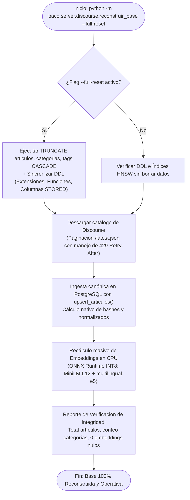

# Plan de Implementación: Script Unificado de Reconstrucción Total (Disaster Recovery)
**Proyecto BACO — Sincronización e Índice Derivado desde Discourse**

---

## 1. Objetivo y Compromiso Técnico

Honrar la premisa arquitectónica acordada con Finnegans:
> *"PostgreSQL funciona como un índice de deduplicación derivado: Discourse es la única fuente de verdad y la base de datos de BACO se puede descartar y reconstruir al 100% en cualquier momento."*

El comando unificado de un solo paso a ejecutar será:
```bash
python -m baco.server.discourse.reconstruir_base --full-reset
```

---

## 2. Mapa de Componentes y Funciones Existentes a Reutilizar

No se requiere desarrollar lógica compleja desde cero; el script actuará como un orquestador secuencial que aprovecha los módulos ya probados:

| Paso | Responsabilidad | Módulo / Función Existente |
| :--- | :--- | :--- |
| **Paso 1: DDL & Limpieza** | Crear extensiones, funciones SQL regex, columnas STORED y vaciar tablas si se usa `--full-reset`. | `baco.server.db.migrar_y_sincronizar_todo.sincronizar_esquema_ddl()` |
| **Paso 2: Descarga Paginada** | Descargar el catálogo completo desde `/latest.json` con control de *rate limits* (429) y backoff exponencial. | `baco.server.discourse.descargar_articulos.listar_temas()` |
| **Paso 3: Ingesta Canónica** | Guardar artículos, categorías y tags en PostgreSQL. Las columnas calculadas (`hash_titulo`, `base_titulo`, `texto_sin_headers`) se autogeneran en la base. | `baco.server.db.ingesta.upsert_articulos()` |
| **Paso 4: Embeddings Batch** | Recalcular vectores semánticos de título (384 dim) y texto (768 dim) en lotes de 64 usando ONNX INT8 en CPU. | `baco.server.db.migrar_y_sincronizar_todo.recalcular_embeddings_completos()` |
| **Paso 5: Auditoría Final** | Reportar total de artículos, categorías, verificar 0 embeddings huérfanos/nulos y confirmar estado de índices HNSW. | Query SQL de verificación en `migrar_y_sincronizar_todo.py` |

---

## 3. Diagrama de Flujo del Script Orquestador



---

## 4. Esqueleto / Plantilla del Script a Crear

Ubicación de destino: `baco/server/discourse/reconstruir_base.py`

```python
"""
Script Unificado de Reconstrucción Total (Disaster Recovery) para BACO.
Uso:
    python -m baco.server.discourse.reconstruir_base --full-reset
"""
import argparse
import logging
import sys
import time
from pathlib import Path

PROJECT_ROOT = Path(__file__).resolve().parents[3]
sys.path.insert(0, str(PROJECT_ROOT))

from baco.server.db.config import get_conn
from baco.server.db.migrar_y_sincronizar_todo import (
    sincronizar_esquema_ddl,
    recalcular_embeddings_completos,
)
from baco.server.db.ingesta import upsert_articulos
from baco.server.discourse.descargar_articulos import listar_temas, limpiar_texto

logging.basicConfig(level=logging.INFO, format="%(asctime)s [%(levelname)s] %(message)s")
logger = logging.getLogger("reconstruir_base")

def vaciar_tablas(conn):
    logger.info("Vaciando tablas para reconstrucción total (--full-reset)...")
    with conn.cursor() as cur:
        cur.execute("TRUNCATE TABLE articulos, categorias, tags CASCADE;")
    conn.commit()
    logger.info("Tablas vaciadas exitosamente.")

def main():
    parser = argparse.ArgumentParser(description="Reconstrucción integral de la base de BACO desde Discourse.")
    parser.add_argument("--full-reset", action="store_true", help="Borra todos los datos actuales antes de reconstruir.")
    args = parser.parse_args()

    t_inicio = time.perf_counter()
    with get_conn() as conn:
        # 1. Esquema DDL
        sincronizar_esquema_ddl(conn)
        
        # 2. Reset si fue solicitado
        if args.full_reset:
            vaciar_tablas(conn)
            
        # 3. Descarga e Ingesta desde Discourse
        logger.info("Iniciando descarga e ingesta de Discourse...")
        # (Llamada al generador de temas + upsert_articulos)
        
        # 4. Generación masiva de embeddings
        logger.info("Generando embeddings ONNX INT8...")
        recalcular_embeddings_completos(conn)
        
        # 5. Verificación de integridad final
        with conn.cursor() as cur:
            cur.execute("SELECT count(*) FROM articulos WHERE embedding_texto IS NULL;")
            pendientes = cur.fetchone()[0]
            cur.execute("SELECT count(*) FROM articulos;")
            total = cur.fetchone()[0]
            logger.info(f"Reconstrucción finalizada. Total artículos: {total}. Pendientes: {pendientes}.")

    tiempo_total = time.perf_counter() - t_inicio
    logger.info(f"Pipeline completado exitosamente en {tiempo_total:.2f} segundos.")

if __name__ == "__main__":
    main()
```
