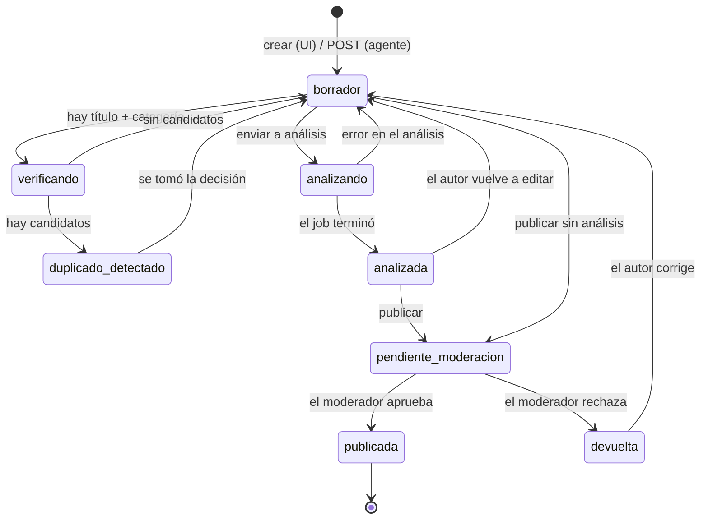

# Máquina de estados de una entrada

Emiliano pidió una máquina de estados dentro de BACO para gestionar por qué pasa una publicación. Esto es el borrador: sirve igual para el panel (son sus pantallas) y para el backend.

## Los estados

| Estado | Qué significa | Qué ve el usuario |
|---|---|---|
| `borrador` | Se está escribiendo. Es el estado por defecto y al que se vuelve siempre. | Formulario editable |
| `verificando` | Chequeo determinista en curso contra Discourse. Dura milisegundos. | Barra de progreso en el panel de duplicados |
| `duplicado_detectado` | Hay candidatos por encima del umbral. **Bloquea publicar** hasta decidir. | Lista de candidatos con score y las tres salidas |
| `analizando` | Análisis agéntico asincrónico en curso. Puede tardar. | Aviso de "en análisis"; se puede seguir editando o cerrar |
| `analizada` | Volvió el análisis con hallazgos y gaps. | Panel de hallazgos separados en bloqueantes y avisos |
| `pendiente_moderacion` | Enviada. Espera a un moderador. | Pantalla de confirmación, solo lectura |
| `publicada` | Visible en la Base de Conocimiento. | Link a la entrada publicada |
| `devuelta` | El moderador la rechazó con comentarios. | Comentarios del moderador + formulario editable |

## Reglas que respeta el panel

**No se puede publicar si:**
- Falta título, categoría, cuerpo, o hay menos de dos etiquetas
- Ninguna etiqueta es de tipo de documentación
- El estado es `duplicado_detectado` y no se tomó decisión
- El último análisis dejó hallazgos `bloqueante` sin resolver

**Editar siempre devuelve a `borrador`.** Si el autor toca el texto después de un análisis, ese análisis queda obsoleto: la UI lo marca como vencido en vez de mostrarlo como si siguiera valiendo.

**`verificando` no bloquea la escritura.** Corre de fondo, con debounce, mientras la persona sigue tipeando.

## Dos cosas a confirmar con el backend

1. **`analizando` en paralelo a la edición.** Hoy el panel deja seguir escribiendo mientras corre el análisis, y marca el resultado como vencido si el texto cambió. La alternativa es congelar el formulario. Es una decisión de experiencia, no técnica.

2. **Quién manda en el estado.** Hoy el panel refleja el `estado` que devuelve el backend y no lo calcula por su cuenta, salvo `verificando`, que es puramente visual. Conviene mantenerlo así: una sola fuente de verdad.
